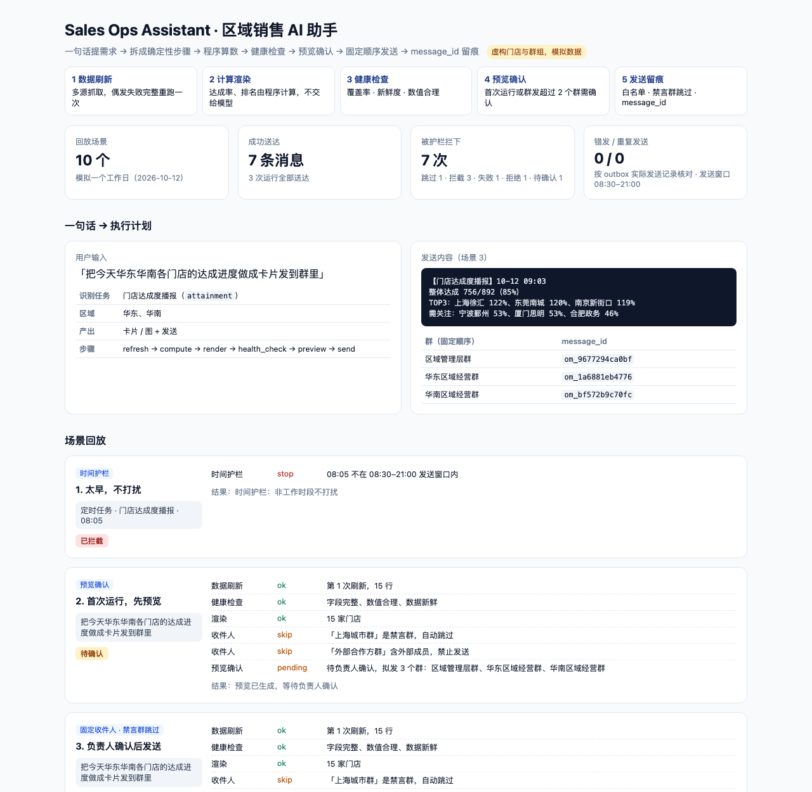
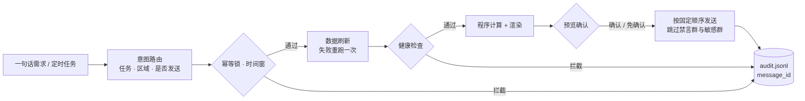
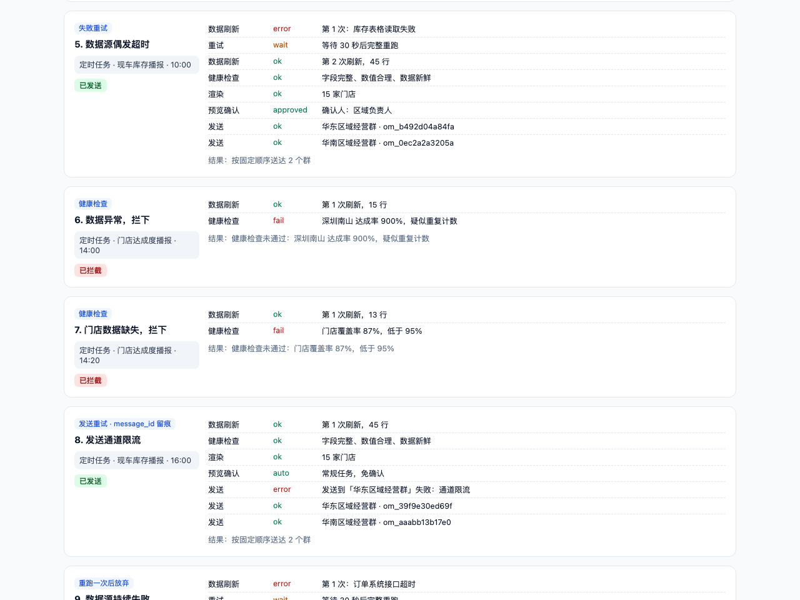

# Sales Ops Assistant · 区域销售 AI 助手

**让 AI 助手往业务群里发数据之前，先回答五个问题：数据新不新、数字对不对、该不该现在发、该发给谁、发错了能不能查。**


> **Copyright © 2026 张文婧 (Anna Zhang)** · [MIT License](./LICENSE) · [github.com/annawzhang](https://github.com/annawzhang)  
> 欢迎学习与面试查阅；保留版权与许可声明。**禁止删除作者信息后冒充本人作品二次发表。** 公开内容为虚构/脱敏演示数据。


[场景回放](https://annawzhang.github.io/sales-ops-assistant/) · 纯 Python 标准库，无第三方依赖

区域销售每天要查数、做表、截图、发群。交给 AI 助手后，真正的风险不在「会不会写」，而在重复发送、发出残缺数据、
非工作时间打扰、发错群。这个项目把一次性的问答工具做成一条**确定性流水线**，并把每一道护栏都做成可测试的代码。

> 门店、群组与数据全部虚构。



## 解决什么问题

| 风险 | 护栏 |
|---|---|
| 调度器重复触发，同一份播报发两遍 | **幂等锁**：同一任务、同一天、同一半天只执行一次 |
| 数据源偶发超时，发出半截数据 | **失败重试**：等待后完整重跑一次，仍失败就不发，通知负责人 |
| 晚上十点给全区域推消息 | **时间护栏**：超出 08:30–21:00 发送窗口自动停止 |
| 某门店重复计数，达成率 900% 被公开 | **健康检查**：门店覆盖率、数据新鲜度、数值合理性，任一不过即拦截 |
| 新任务直接群发，没人看过 | **预览确认**：首次运行或一次发往超过 2 个群，需负责人确认 |
| 发到禁言群、含外部成员的群 | **收件人白名单**：固定收件人和顺序；禁言群跳过；敏感群即使误配也拦下 |
| 「发到所有群」这类越权请求 | **意图路由**：只能发到任务配置里的收件人，越权请求直接拒绝 |
| 出了问题查不到发了什么 | **留痕**：每一步写入 `audit.jsonl`，每条消息带 `message_id` |

## 流水线



指标（达成率、排名、库存）全部由程序计算，模型只负责理解需求，不负责生成数字。

## 一天的场景回放



| # | 场景 | 护栏 | 结果 |
|---|---|---|---|
| 1 | 08:05 定时任务 | 时间护栏 | 拦截 |
| 2 | 首次运行「把今天各门店达成发到群里」 | 预览确认 | 待确认 |
| 3 | 负责人确认后 | 固定收件人、禁言群和敏感群跳过 | 送达 3 个群 |
| 4 | 调度器重复触发 | 幂等锁 | 跳过 |
| 5 | 库存表格读取超时 | 失败重试 | 第 2 次成功，送达 |
| 6 | 某门店达成率 900% | 健康检查 | 拦截 |
| 7 | 2 家门店数据缺失 | 健康检查 | 拦截 |
| 8 | 发送通道限流 | 发送重试 + message_id | 送达 |
| 9 | 订单系统持续超时 | 重跑一次后放弃 | 未发送任何内容 |
| 10 | 「把库存发到所有群」 | 意图路由 | 拒绝 |

## 快速开始

```bash
python3 run.py                         # 回放场景，生成 docs/index.html 与 docs/audit.jsonl
python3 -m unittest discover -s tests  # 10 个测试
```

| 文件 | 作用 |
|---|---|
| `config/assistant.toml` | 发送窗口、重试、健康阈值、确认规则、群组与任务收件人 |
| `assistant/intents.py` | 一句话 → 结构化任务 |
| `assistant/data.py` | 模拟数据源，可注入超时、缺数、异常值 |
| `assistant/pipeline.py` | 流水线与全部护栏 |
| `assistant/scenarios.py` | 一个工作日的 10 个场景 |
| `assistant/report.py` | 场景回放页 |

## 设计取舍

- **失败就整条重跑，而不是从断点续跑**：续跑容易拼出「一半新一半旧」的数据，整条重跑更慢但结果一致。
- **只重试一次**：偶发故障一次就够，持续故障多试几次也只会把消息推迟到没人看的时候。
- **锁在发送前才加**：被健康检查拦下或等待确认的任务不占锁，修好数据后同一时段还能再发。
- **部分送达照样记账**：某个群发送失败不影响后面的群，结果标记为部分送达并留痕，方便补发。

## 背景

本项目是作者在汽车区域销售策略实习中所做「区域销售 AI 助手」的公开复刻版：确定性流水线、幂等锁、
失败重试、时间护栏、群发授权与禁言群保护的设计与原工作一致，系统名称做了泛化，门店与数据均为虚构。
